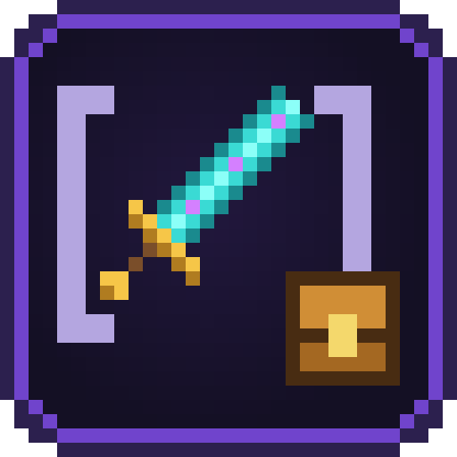
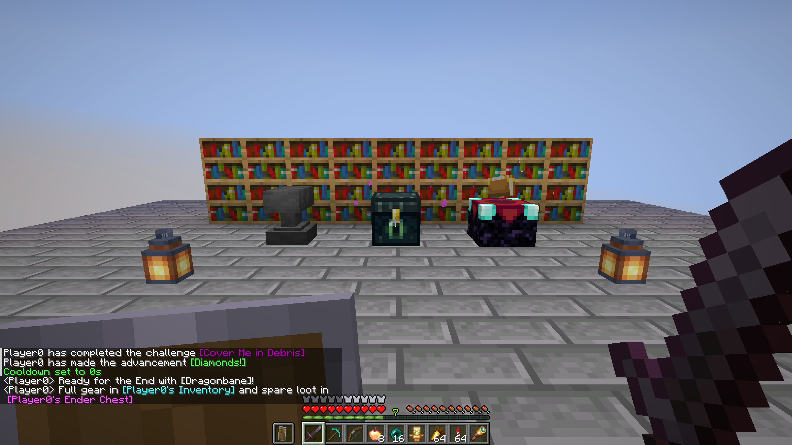
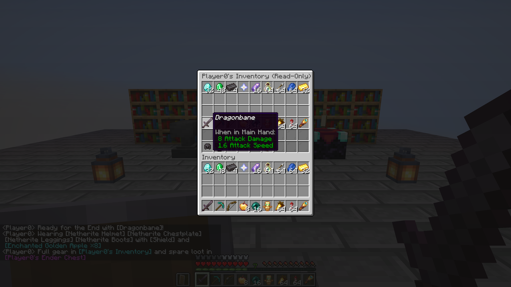

# Chat Items

**English** · [Русский](README.ru.md)

Type **`[item]`**, **`[inv]`** or **`[ender]`** in chat to show the item in your hand with its full tooltip or share a clickable, read-only snapshot of your inventory or Ender chest. Works entirely on the server — players with vanilla clients see everything without installing the mod.

## Contents

- [How it works](#how-it-works)
- [What works where](#what-works-where)
- [Versions and files](#versions-and-files)
- [Commands](#commands)
- [Settings](#settings)
- [Questions and problems](#questions-and-problems)
- [Building](#building)

## How it works

| What you type | What appears in chat | What happens on hover or click |
|---|---|---|
| `[item]`, `[i]`, `[hand]` | `[Sword Name ×count]` in the item's rarity color (falls back to off-hand if main hand is empty) | Shows the full native Minecraft item tooltip (enchantments, durability, attribute modifiers, lore, and components); if the item is a Shulker Box, clicking opens a read-only view of all 27 slots |
| `[offhand]`, `[off]` | `[Shield]` in the item's rarity color | Shows the full tooltip of the item in your off-hand |
| `[armor]`, `[armour]` | `[Helmet] [Chestplate] [Leggings] [Boots]` | Shows all worn armor pieces inline, each with its own rarity color and full hover tooltip |
| `[slot1]` – `[slot9]`, `[s1]` – `[s9]` | `[Item Name ×count]` from hotbar slot 1–9 | Shows the item in that hotbar slot without switching your held item |
| `[inv]`, `[inventory]` | `[Player's Inventory]` in aqua | Clicking opens a read-only 6-row chest view with armor, off-hand, main inventory, and hotbar frozen at the moment the message was sent |
| `[ender]`, `[enderchest]`, `[ec]` | `[Player's Ender Chest]` in light purple | Clicking opens a read-only 3-row chest view of the player's Ender chest frozen at the moment the message was sent |

- **Shulker Box inspection:** clicking any Shulker Box inside an open `[inv]` or `[ender]` window opens its 27 slots in a read-only view with a `← Back` button to return to the inventory or Ender chest.
- **Immutable snapshots:** changing your items after sending `[inv]` or `[ender]` does not change the snapshot in chat. Snapshots expire automatically after a configurable time.
- **Strict read-only view:** clicking, shift-clicking, number-key swapping, dragging, double-clicking, or dropping inside a snapshot window is blocked on the server and resynchronized immediately.
- **Anti-spam limits & permissions:** configurable maximum number of tokens per message and a per-player cooldown keep chat clean; Paper/Spigot servers also support LuckPerms permissions (`chatitems.item`, `chatitems.inv`, `chatitems.ender`, `chatitems.bypass.cooldown`, `chatitems.admin`).

## What works where

| Client | Server | Result |
|---|---|---|
| vanilla (no mod) | Fabric, Quilt, Forge, NeoForge with the mod | Everything works: item tooltips and clickable read-only `[inv]` / `[ender]` windows |
| vanilla (no mod) | Paper, Purpur, Folia, Spigot with the plugin | Everything works: item tooltips and clickable read-only `[inv]` / `[ender]` windows |
| singleplayer / LAN | Fabric, Quilt, Forge, NeoForge with the mod | Everything works in singleplayer and LAN worlds |

## Versions and files

Three files cover every supported Minecraft version and loader: each universal mod JAR picks the right build when the game starts.

| File | For | Minecraft | Java |
|---|---|---|---|
| `chat-items-fabric-<version>+mc1.16.5-26.x.jar` | Fabric, Quilt (needs [Fabric API](https://modrinth.com/mod/fabric-api)) | 1.16.5 – 1.21.11, 26.1 – 26.3 | 8+ (1.18+: 17, 1.20.5+: 21, 26.x: 25) |
| `chat-items-forge-neoforge-<version>+mc1.16.5-26.x.jar` | Forge, NeoForge | Forge 1.16.5 – 26.3; NeoForge 1.20.1 – 26.3 | 8+ (1.18+: 17, 1.20.5+: 21, 26.x: 25) |
| `chat-items-bukkit-<version>.jar` | Paper, Purpur, Folia, Spigot, Bukkit | 1.16.5 – 26.3 | 8+ |

Put the mod into the server's `mods/` folder (or `.minecraft/mods/` for singleplayer / LAN); put the plugin into the server's `plugins/` folder. Clients do not need to install anything.

## Commands

| Command | Who | What it does |
|---|---|---|
| `/chatitems` or `/chatitems status` | everyone | Shows the version, whether `[item]`, `[inv]`, and `[ender]` are enabled, the limits, and how many snapshots are cached |
| `/chatitems view <id>` | everyone | Opens a shared `[inv]` or `[ender]` snapshot (used automatically when clicking a tag in chat) |
| `/chatitems reload` | operators (`chatitems.admin` on Bukkit) | Reloads `chatitems-server.properties` from disk (changes are also picked up automatically within a few seconds) |
| `/chatitems enabled <true\|false>` | operators (`chatitems.admin`) | Turns all chat tokens on or off |
| `/chatitems item <true\|false>` | operators (`chatitems.admin`) | Turns `[item]` (and `[i]`, `[hand]`) on or off |
| `/chatitems inv <true\|false>` | operators (`chatitems.admin`) | Turns `[inv]` on or off |
| `/chatitems ender <true\|false>` | operators (`chatitems.admin`) | Turns `[ender]` on or off |
| `/chatitems max_tokens <1-10>` | operators (`chatitems.admin`) | Sets how many tokens in a single chat message are replaced |
| `/chatitems cooldown <0-300>` | operators (`chatitems.admin`) | Sets the cooldown in seconds between messages with tokens |
| `/chatitems ttl <10-3600>` | operators (`chatitems.admin`) | Sets how long `[inv]` and `[ender]` snapshots stay viewable, in seconds |
| `/chatitems help` | everyone | Lists all `/chatitems` subcommands |

Replies come in each player's game language (13 languages included).

## Settings

`config/chatitems-server.properties` (on Paper / Spigot: `plugins/ChatItems/chatitems-server.properties`):

| Key | Default | Range | What it does |
|---|---|---|---|
| `enabled` | `true` | `true` / `false` | Master switch for all chat tokens |
| `allow_item` | `true` | `true` / `false` | Allow `[item]`, `[i]`, and `[hand]` in chat |
| `allow_inv` | `true` | `true` / `false` | Allow `[inv]` inventory snapshots in chat |
| `allow_ender` | `true` | `true` / `false` | Allow `[ender]` Ender chest snapshots in chat |
| `max_tokens_per_message` | `3` | `1 – 10` | Maximum number of tokens replaced in a single chat message (extra tokens stay as plain text) |
| `cooldown_seconds` | `3` | `0 – 300` | Minimum seconds between token messages from the same player (`0` disables the cooldown) |
| `snapshot_ttl_seconds` | `300` | `10 – 3600` | Seconds an `[inv]` or `[ender]` snapshot remains available after it is shared |
| `language` | `en_us` | language code | Default language for the server console and players whose language is unknown |

Invalid values in the file are logged as a warning and fall back to their default without overwriting what you typed; unknown keys and comments are preserved.

## Questions and problems

[Open an issue](https://github.com/Shamanalle/chat-items/issues/new/choose) with your Minecraft, loader, and mod versions and, if something went wrong, `logs/latest.log`.

## Building

See [CONTRIBUTING.md](CONTRIBUTING.md): `./gradlew build` puts the three release files into `build/libs/`.

## License

[MIT](LICENSE).
