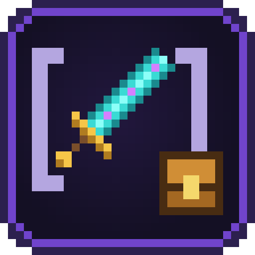
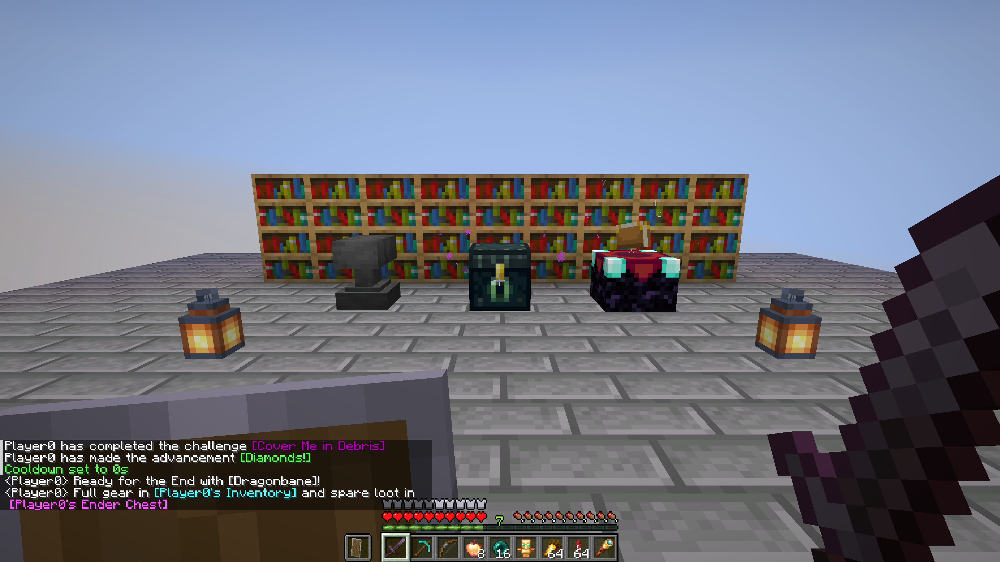
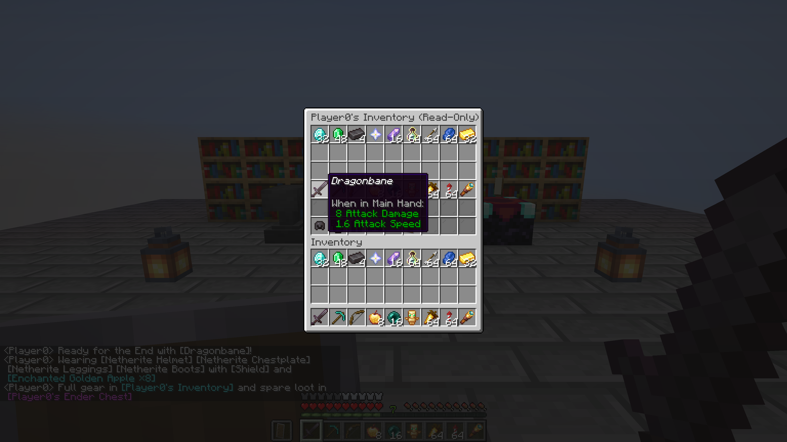

# Chat Items

[English](README.md) · **Русский**

Напишите **`[item]`**, **`[inv]`** или **`[ender]`** в чат, чтобы показать предмет в руке со всеми зачарованиями и подсказкой или поделиться кликабельным снимком инвентаря либо эндер-сундука только для просмотра. Работает полностью на сервере — игроки с ванильным клиентом видят всё без установки мода.

## Содержание

- [Как это работает](#как-это-работает)
- [Что где работает](#что-где-работает)
- [Версии и файлы](#версии-и-файлы)
- [Команды](#команды)
- [Настройки](#настройки)
- [Вопросы и проблемы](#вопросы-и-проблемы)
- [Сборка](#сборка)

## Как это работает

| Что написать в чат | Что появится в чате | Что будет при наведении или клике |
|---|---|---|
| `[item]`, `[i]`, `[hand]` | `[Название предмета ×количество]` в цвете редкости предмета (если основная рука пуста — берётся вторая рука) | Показывает стандартную подсказку предмета Minecraft (зачарования, прочность, атрибуты, описание и компоненты); если в руке шалкеровый ящик — клик открывает просмотр всех 27 слотов |
| `[offhand]`, `[off]` | `[Щит]` в цвете редкости предмета | Показывает полную подсказку предмета во второй руке |
| `[armor]`, `[armour]` | `[Шлем] [Нагрудник] [Поножи] [Ботинки]` | Выводит в строку все надетые элементы брони со своим цветом редкости и всплывающей подсказкой у каждого |
| `[slot1]` – `[slot9]`, `[s1]` – `[s9]` | `[Название ×количество]` из слота хотбара 1–9 | Показывает предмет из нужного слота хотбара, не переключая предмет в руке |
| `[inv]`, `[inventory]` | `[Инвентарь игрока]` бирюзовым цветом | По клику открывает окно из 6 рядов только для просмотра с бронёй, второй рукой, основным инвентарём и хотбаром на момент отправки сообщения |
| `[ender]`, `[enderchest]`, `[ec]` | `[Эндер-сундук игрока]` сиреневым цветом | По клику открывает окно из 3 рядов только для просмотра с содержимым эндер-сундука на момент отправки сообщения |

- **Просмотр шалкеров:** клик по любому шалкеровому ящику внутри открытого окна `[inv]` или `[ender]` открывает его 27 слотов только для просмотра с кнопкой `← Назад` для возврата к инвентарю или эндер-сундуку.
- **Неизменяемые снимки:** если после отправки `[inv]` или `[ender]` переложить вещи, снимок в чате не изменится. Снимки автоматически удаляются по истечении заданного времени.
- **Строгий режим просмотра:** клики, Shift-клики, обмен клавишами 1–9, перетаскивание, двойной клик и выбрасывание предметов в окне снимка блокируются на сервере с мгновенной синхронизацией слотов.
- **Защита от спама и права:** настраиваемый лимит тегов в одном сообщении и кулдаун между отправками защищают чат от засорения; на серверах Paper/Spigot поддерживаются права LuckPerms (`chatitems.item`, `chatitems.inv`, `chatitems.ender`, `chatitems.bypass.cooldown`, `chatitems.admin`).

## Что где работает

| Клиент | Сервер | Что получится |
|---|---|---|
| ванильный (без мода) | Fabric, Quilt, Forge, NeoForge с модом | Всё работает: подсказки предметов и кликабельные окна `[inv]` / `[ender]` |
| ванильный (без мода) | Paper, Purpur, Folia, Spigot с плагином | Всё работает: подсказки предметов и кликабельные окна `[inv]` / `[ender]` |
| одиночная игра / LAN | Fabric, Quilt, Forge, NeoForge с модом | Всё работает в одиночной игре и по сети LAN |

## Версии и файлы

Три файла закрывают все поддерживаемые версии Minecraft и загрузчики: каждый универсальный JAR мода сам выбирает нужную сборку при запуске.

| Файл | Для чего | Minecraft | Java |
|---|---|---|---|
| `chat-items-fabric-<версия>+mc1.16.5-26.x.jar` | Fabric, Quilt (нужен [Fabric API](https://modrinth.com/mod/fabric-api)) | 1.16.5 – 1.21.11, 26.1 – 26.3 | 8+ (1.18+: 17, 1.20.5+: 21, 26.x: 25) |
| `chat-items-forge-neoforge-<версия>+mc1.16.5-26.x.jar` | Forge, NeoForge | Forge 1.16.5 – 26.3; NeoForge 1.20.1 – 26.3 | 8+ (1.18+: 17, 1.20.5+: 21, 26.x: 25) |
| `chat-items-bukkit-<версия>.jar` | Paper, Purpur, Folia, Spigot, Bukkit | 1.16.5 – 26.3 | 8+ |

Положите мод в папку `mods/` сервера (или `.minecraft/mods/` для одиночной игры и LAN), а плагин — в `plugins/` сервера. Игрокам ставить мод на клиент не нужно.

## Команды

| Команда | Кто | Что делает |
|---|---|---|
| `/chatitems` или `/chatitems status` | все | Показывает версию, включены ли `[item]`, `[inv]` и `[ender]`, лимиты и сколько снимков сейчас в кэше |
| `/chatitems view <id>` | все | Открывает снимок `[inv]` или `[ender]` (вызывается автоматически при клике по тегу в чате) |
| `/chatitems reload` | операторы (`chatitems.admin` на Bukkit) | Перечитывает `chatitems-server.properties` с диска (изменения также подхватываются автоматически через несколько секунд) |
| `/chatitems enabled <true\|false>` | операторы (`chatitems.admin`) | Включает или выключает все теги чата |
| `/chatitems item <true\|false>` | операторы (`chatitems.admin`) | Включает или выключает `[item]` (а также `[i]`, `[hand]`) |
| `/chatitems inv <true\|false>` | операторы (`chatitems.admin`) | Включает или выключает `[inv]` |
| `/chatitems ender <true\|false>` | операторы (`chatitems.admin`) | Включает или выключает `[ender]` |
| `/chatitems max_tokens <1-10>` | операторы (`chatitems.admin`) | Задаёт максимум тегов, заменяемых в одном сообщении чата |
| `/chatitems cooldown <0-300>` | операторы (`chatitems.admin`) | Задаёт задержку в секундах между сообщениями с тегами |
| `/chatitems ttl <10-3600>` | операторы (`chatitems.admin`) | Задаёт время хранения снимков `[inv]` и `[ender]` в секундах |
| `/chatitems help` | все | Выводит список всех подкоманд `/chatitems` |

Ответы приходят на языке игры каждого игрока (встроено 13 языков).

## Настройки

`config/chatitems-server.properties` (на Paper / Spigot: `plugins/ChatItems/chatitems-server.properties`):

| Ключ | По умолчанию | Диапазон | Что делает |
|---|---|---|---|
| `enabled` | `true` | `true` / `false` | Общий переключатель всех тегов в чате |
| `allow_item` | `true` | `true` / `false` | Разрешить `[item]`, `[i]` и `[hand]` в чате |
| `allow_inv` | `true` | `true` / `false` | Разрешить снимки инвентаря `[inv]` в чате |
| `allow_ender` | `true` | `true` / `false` | Разрешить снимки эндер-сундука `[ender]` в чате |
| `max_tokens_per_message` | `3` | `1 – 10` | Максимум заменяемых тегов в одном сообщении (лишние остаются обычным текстом) |
| `cooldown_seconds` | `3` | `0 – 300` | Минимальный интервал в секундах между сообщениями с тегами от одного игрока (`0` — без задержки) |
| `snapshot_ttl_seconds` | `300` | `10 – 3600` | Время жизни снимка `[inv]` или `[ender]` в секундах после отправки |
| `language` | `en_us` | код языка | Язык по умолчанию для консоли сервера и игроков, чей язык неизвестен |

Некорректные значения записываются в лог с предупреждением и заменяются значением по умолчанию без перезаписи того, что вы ввели; неизвестные ключи и комментарии сохраняются.

## Вопросы и проблемы

[Создайте issue](https://github.com/Shamanalle/chat-items/issues/new/choose), указав версии Minecraft, загрузчика и мода, а при ошибке приложите `logs/latest.log`.

## Сборка

См. [CONTRIBUTING.md](CONTRIBUTING.md#русский): `./gradlew build` собирает три релизных файла в `build/libs/`.

## Лицензия

[MIT](LICENSE).
