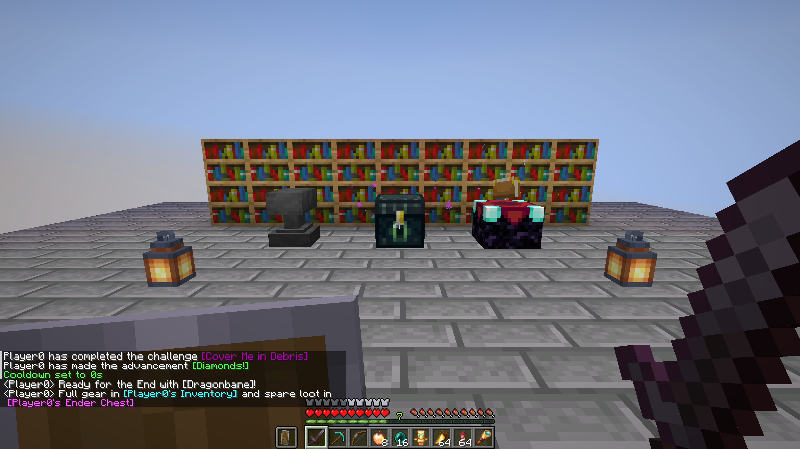

In vanilla Minecraft there is no quick way to show other players the exact roll on your sword or what is inside your inventory without dropping items on the ground. **Chat Items** adds simple chat tags that work entirely on the server — vanilla clients see everything without installing the mod.

- **`[item]` (or `[i]`, `[hand]`), `[offhand]`, `[armor]`, `[slot1]`–`[slot9]`:** replaces the tag in your message with the name and stack count of the item (or all worn armor pieces), colored by rarity, with the full native Minecraft item tooltip (enchantments, durability, attribute modifiers, lore, and components) when hovered.
- **`[inv]` and `[ender]` (plus Shulker Box inspection):** captures an immutable snapshot of your inventory (including armor and off-hand) or Ender chest and inserts a clickable tag in chat. Anyone who clicks it opens a read-only chest view that blocks taking, moving, swapping, or duplicating items — and clicking any Shulker Box inside opens its 27 slots with a `← Back` button.
- **Anti-spam, permissions & controls:** configurable token limit per message, per-player cooldown, snapshot expiration time, and LuckPerms permissions (`chatitems.item`, `chatitems.inv`, `chatitems.ender`, `chatitems.bypass.cooldown`, `chatitems.admin`), all adjustable in game via `/chatitems` or in `chatitems-server.properties` with hot reload.
- **13 languages:** replies and tags are localized to each player's game language.

Three files cover everything: one for Fabric and Quilt (Minecraft 1.16.5 – 1.21.11 and 26.1 – 26.3, needs Fabric API), one for Forge 1.16.5 – 26.3 and NeoForge 1.20.1 – 26.3, and a server plugin for Paper, Purpur, Folia, and Spigot 1.16.5 – 26.3.

[Source and details](https://github.com/Shamanalle/chat-items) · [Bugs and ideas](https://github.com/Shamanalle/chat-items/issues)

Русский

В обычном Minecraft нельзя быстро показать другим игрокам зачарования на мече или содержимое своего инвентаря, не выбрасывая вещи на землю. **Chat Items** добавляет простые теги чата, которые работают полностью на стороне сервера — игроки с обычным клиентом без мода видят всё.

- **`[item]` (или `[i]`, `[hand]`), `[offhand]`, `[armor]`, `[slot1]`–`[slot9]`:** подставляет в сообщение название и количество предмета (или всю надетую броню) в цвете редкости, а при наведении курсора показывает стандартную подсказку Minecraft со всеми зачарованиями, прочностью, описанием и компонентами.
- **`[inv]` и `[ender]` (плюс просмотр шалкеров):** сохраняет неизменяемый снимок вашего инвентаря (включая броню и вторую руку) или эндер-сундука и вставляет кликабельную ссылку в чат. Любой нажавший игрок открывает окно сундука только для просмотра, откуда нельзя забрать, переложить или дюпнуть вещи, а по клику на шалкеровый ящик внутри открываются его 27 слотов с кнопкой `← Назад`.
- **Защита от спама, права и управление:** лимит тегов на сообщение, кулдаун между отправками, время жизни снимков и права LuckPerms (`chatitems.item`, `chatitems.inv`, `chatitems.ender`, `chatitems.bypass.cooldown`, `chatitems.admin`), настраиваемые прямо из игры через `/chatitems` или в `chatitems-server.properties` с горячей перезагрузкой.
- **13 языков:** ответы и подписи переводятся на язык игры каждого игрока.

Всего три файла: для Fabric и Quilt (Minecraft 1.16.5 – 1.21.11 и 26.1 – 26.3, нужен Fabric API), для Forge 1.16.5 – 26.3 и NeoForge 1.20.1 – 26.3, а также плагин для серверов Paper, Purpur, Folia и Spigot 1.16.5 – 26.3.

[Исходники и подробности](https://github.com/Shamanalle/chat-items) · [Ошибки и идеи](https://github.com/Shamanalle/chat-items/issues)

